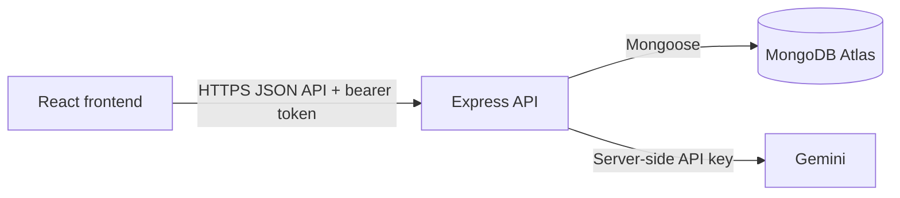

# Campus Lost & Found API

TypeScript, Express, and MongoDB API for the Campus Lost & Found app.

## Live deployment

- API deployment: [https://itelect4-backend.vercel.app](https://itelect4-backend.vercel.app)
- Frontend: [https://itelect4-project-it4b.vercel.app](https://itelect4-project-it4b.vercel.app)

## Setup

1. Use Node.js 24 or newer and run `npm ci`.
2. Copy `.env.example` to `.env` and fill in `MONGODB_URI`, `JWT_SECRET`, `CORS_ORIGIN`, and `GEMINI_API_KEY`. Set `PORT` only when overriding the default port `4000`.
3. Start the API with `npm run dev`.
4. Seed the public item categories with `npm run seed:categories`.

`CORS_ORIGIN` is a comma-separated list of exact browser origins. It is configured above for local frontend development.

## Scripts

- `npm run dev` starts the watch server.
- `npm run typecheck` type-checks application and test code.
- `npm test` runs the route tests.
- `npm run build` compiles the API to `dist/`.
- `npm start` runs the compiled server.
- `npm run seed:categories` upserts the five item categories into MongoDB.

## API

- `GET /api/health` reports API and database readiness.
- `POST /api/auth/register` and `POST /api/auth/login` register accounts and issue JWTs.
- `GET /api/categories` and `GET /api/categories/:id` provide public item categories.
- `GET /api/items` and `GET /api/items/:id` provide public item browsing. Creating, editing, and deleting items requires a bearer token and is limited to the item's owner.
- `POST /api/claims` lets authenticated users claim items. Item owners can review their item's claims; administrators can review all claims.
- `POST /api/ai` reviews a project description for an authenticated user, with a five-request-per-minute limit. It uses the server-only `GEMINI_API_KEY`.

## Architecture

## Security and testing

The backend reads `MONGODB_URI`, `JWT_SECRET`, `CORS_ORIGIN`, `GEMINI_API_KEY`, and optional `PORT` from its environment. Never commit `.env` or production credentials. The API authentication tests use a test-only JWT secret and mock MongoDB; they do not call Gemini or require external services.

GitHub Actions runs type checks, tests, and a build on every push and on pull requests to `main`. CI uses no production secrets.

**AI-use disclosure:** AI tools assisted with implementation and test drafting; the changes and test results were reviewed locally.
